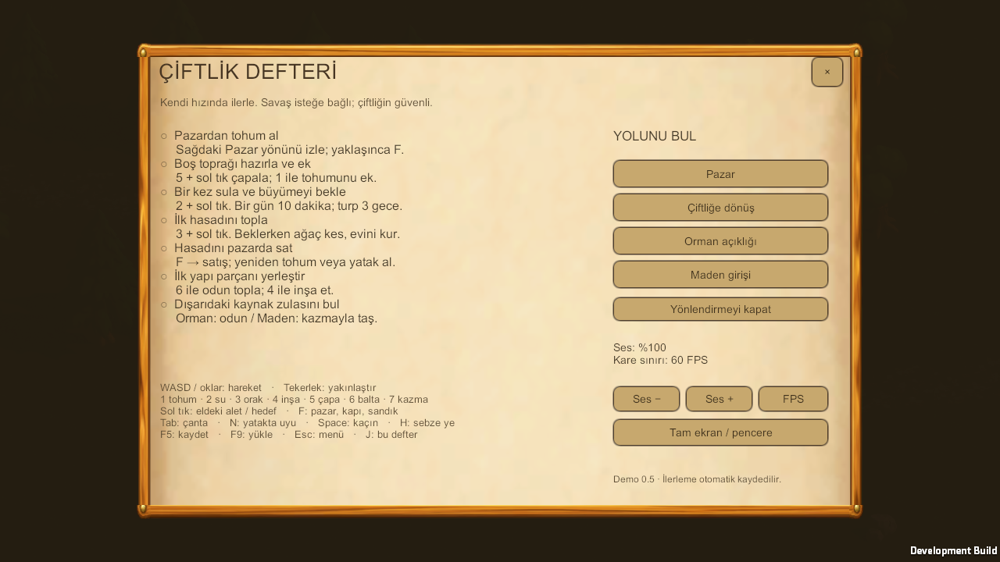
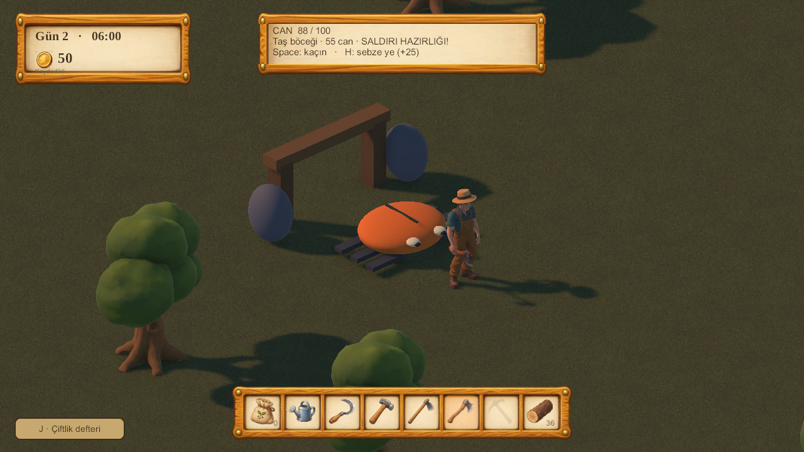

# 0.5 demo adayı — oynanış ve doğrulama

11 Ekim 2026. Kullanıcı 0.4 ve 0.5 çalışmalarının özerk tamamlanmasını, geçici
stilize modelleri, rutin denge kararlarını ve doğrulanan kodun pushlanmasını onayladı.

## Kapsam

0.4: iki isteğe bağlı karşılaşma, slime ve taş böceği; balta saldırısı, Space ile
kaçınma, H ile sebze yeme, yatakta tam iyileşme, hafif yenilgi ve günlük kaynak
zulaları. Çiftlik merkezinde düşman yok; düşmanlar evlerinden 7–7,5 m uzaklaşmaz.
Maden girişi mevcut dünya üzerinde bir karşılaşmadır, ayrı mağara sahnesi değildir.
Oyuncunun sahnesi yeniden üretilmez. Karşılaşma konumları ilk kez boş, uygun zemine
seçilir ve kayıtla korunur; ekili/kapalı yeniden doğma noktalarına düşman sıkıştırılmaz.

0.5: ilk başlangıçta açılan ve J ile tekrar erişilen çiftlik defteri; başarılı
işlemlerden kalıcı ilerleme; pazar/çiftlik/orman/maden yönlendirmesi; ses seviyesi,
30/60/120 FPS sınırı, tam ekran; savaş sesleri; v12 kayıt geçişi; platform başına
build/paketleme ve oyun içi kısa kontrol aracı.

## Başlangıç turu (tasarım hedefi)

- 0–10 dakika: pazar yönünü takip et, tohum al, çapa → ekim → tek sulama.
- 10–25 dakika: odun/yabani tohum/sandık keşfi, ilk oda veya çit. Gelire göre yatak/kazma.
- 25–40 dakika: ilk turp hasadı ve satış, ikinci ürün ve sebze kasası.
- 40–60 dakika: yataklı oda, isteğe bağlı orman/maden karşılaşması, hasat sepeti hedefi.

Bu bir oturum ölçümü değildir. Bir gün 10 gerçek dakika, turp üç gece büyür.
Uyuma ve rastgele sandıklar süreyi değiştirebilir. Altı ürün/tarif dengesi için
[DENGE_03.md](DENGE_03.md) geçerlidir; tarım değerleri bu tur değiştirilmedi.

## Savaş dengesi

| Kural | Değer |
|---|---|
| Oyuncu canı | 100 |
| Balta | 15 hasar / 0,6 sn; 2,6 m erişim, görüş engeli kontrolü |
| Slime | 35 can; 12 hasar; 0,8 sn hazırlık; 1,4 m/sn |
| Taş böceği | 55 can; 18 hasar; 1,1 sn hazırlık; 1,9 m/sn |
| Kaçınma | 0,24 sn / 8 m/sn; 0,34 sn dokunulmazlık; 1,2 sn bekleme |
| H ile iyileşme | 1 sebze → 25 can; tam canda tüketim yok; buğday yenmez |
| Yenilgi | Başlangıç yakınına güvenli dönüş; tam can; min(10, para/10) kaybı |
| Günlük zula | 12 odun / 12 taş; taş için satın alınmış kazma |

Saldırı telegraph'ı renk, şekil ve kısa sesle okunur. Arayüz, odak kaybı ve inşa
saldırıyı iptal eder; geri dönünce hazırlıksız ani hasar verilmez. Kaynaklar/çanta
ölümde korunur. Düşman ve günlük ödül bilgisi kayıt yükleyerek çoğaltılamaz.

## Üretim

Unity **6000.3.25f1** ve `Packages/packages-lock.json` kullanılır. Temiz bir
klonda `Assets`, `Packages`, `ProjectSettings` yeterlidir; `Library` kopyalanmaz.
İlgili platformun Mono build desteği aynı editör sürümüne kurulmalıdır. Modüller
[Unity 6000.3.25f1 resmi sürüm sayfasında](https://unity.com/releases/editor/whats-new/6000.3.25f1) bulunur.

```bash
# UNITY_EDITOR değişkenini bu makinedeki editör yürütülebilir dosyasına ayarla.
"$UNITY_EDITOR" -batchmode -quit -job-worker-count 4 -projectPath "$PWD" -buildTarget Win64 \
  -executeMethod Farmer.Editor.DemoBuild.Build --farmer-demo-target windows \
  -logFile "$PWD/Logs/demo-windows-build.log"
python3 tools/build/package_demo.py --platform windows

"$UNITY_EDITOR" -batchmode -quit -job-worker-count 4 -projectPath "$PWD" -buildTarget Linux64 \
  -executeMethod Farmer.Editor.DemoBuild.Build --farmer-demo-target linux \
  -logFile "$PWD/Logs/demo-linux-build.log"
python3 tools/build/package_demo.py --platform linux
```

Mac için `-buildTarget OSXUniversal --farmer-demo-target mac`. Yerel giriş testi
build'ine `--farmer-demo-development` eklenir. Test oyuncusu
`--farmer-smoke-capture <yeni-png-yolu> --farmer-check-demo` ile açılır; normal
oyuncunun kaydına dokunmayan ayrı QA kaydı kullanılır. Paketleyici release için
geliştirme build'ini reddeder; teknik test paketi açıkça `--allow-development` ister.

`FARMER_DEMO_BUILD_OK` ve çıkış 0 olmadan paketleme yapılmaz. Paketleyici platform
başlığını, sürüm bilgisini, gerekli dosyaları, ZIP CRC ve SHA-256'yı kontrol eder;
`MANIFEST.json` içerik hash'lerini ve `BENI_OKU.txt` kontrolleri taşır.

## Doğrulanan aday

Kaynak `f9c8804`; yerel sahne ve temiz klonda 186/186 EditMode, 8/8 PlayMode.
Native Mac development oyuncusunda 8 demo giriş kontrolü ve 8 menü/tam ekran
kontrolü geçti. Defter ve savaş görüntüleri:





Temiz klonun ilk PlayMode açılışı Unity asset garbage collector'da bekledi;
yalnızca o batch süreç durduruldu ve dört işçiyle tekrar 8/8 geçti. Bu ilk deneme
başarılı sayılmadı. Standalone çalışmasında aynı durum görülmedi.

## Hazır paketler

`f9c8804` kaynağından Windows x64 ve Linux x64 StrictMode release build üretildi.
ZIP'ler yerel `builds/Releases/` içindedir; Git'e eklenmez. Her paketin yanında
`.zip.sha256`, içinde `MANIFEST.json`, `build-info.json` ve `BENI_OKU.txt` vardır.

| Paket | Boyut | Runtime dosyası |
|---|---:|---:|
| Farmer-0.5.0-windows.zip | 122,9 MiB | 168 |
| Farmer-0.5.0-linux.zip | 122,0 MiB | 166 |

CRC, bütün içerik hash'leri ve release/sourceRevision bilgileri doğrulandı.
Linux yürütülebilir dosyasının çalıştırma izni ZIP'te korunuyor. Gerçek Windows
ve Linux donanımında bu paketler henüz açılmadı; native giriş testi Mac'te yapıldı.

## Açık kabul noktaları

- Windows ve Linux'ta gerçek donanım üzerinde açılış, ses, giriş ve uzun oturum.
- Bir oyuncunun sözlü yardım olmadan yaklaşık bir saatlik başlangıç turu.
- Nihai bitki/düşman/maden modelleri; geçici görseller kullanıcı tarafından bu tur için onaylı.
- Büyük yapı yerleşiminde uzun süreli performans, düşmanların karmaşık labirentlerde davranışı.
  Düşmanlar kısa mesafede çarpışarak yön değiştirir; genel amaçlı yol bulma sistemi yoktur.

Bu kabul noktaları geçmeden 0.5'e nihai demo onayı verilmez. Uygulama ve paketleme
sonuçlarının güncel kanıtları YAZILIMCI.md'nin son kaydındadır.


### 12 Ekim savaş düzeltmesi

Kaynak kodundaki yeni savaş: 0,2 s temas gecikmesi, 65 ms hit-stop, savurma izi,
hasar sayıları, düşman/oyuncu can barı, hazırlık halkası ve sarsılma. Slime ödülü
otomatik 12 odun; böcek ödülü kazma sahipliğinde otomatik 12 taş. Alınamayan
kaynak görünür kalır. Keşif noktaları gerçek çiftlik başlangıcına yaklaştırıldı.
Önceki Windows/Linux ZIP'leri bu değişiklikleri içermez; yeniden paketlenmeden
bu yeni sürümün paketi olarak paylaşılmamalı.
