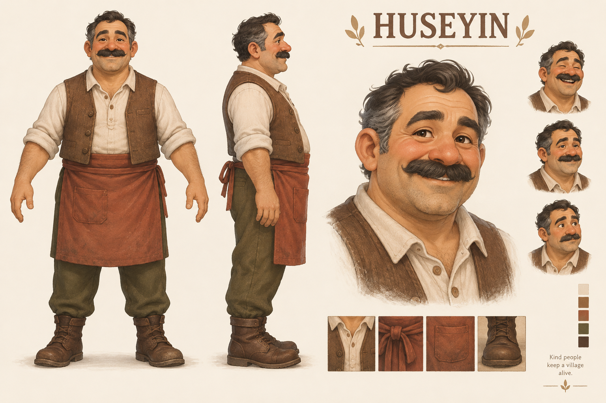

# Hüseyin — pazar esnafı

13 Ekim 2026, yerleşik ImageGen ile üretildi. Tam prompt: [prompt.txt](prompt.txt).

Kullanıcı kararı: erkek, orta yaşlı; adı Hüseyin. Tasarım yaklaşık 48 yaşında, hafif kır saçlı, bıyıklı, güler yüzlü köy esnafı. Krem gömlek, kahverengi yelek, kiremit önlük, zeytin pantolon. Bu resim karakter/3D üretim referansıdır; oyun içindeki model henüz bu tasarım değildir. Geçici olarak kullanıcının izniyle Defne modeli yeniden kullanılıyor.

Model teslim hedefi: yaklaşık 1,7 m boy, taban merkezinde pivot, +Z ileri, GLB veya FBX + dokular. Nötr A pozu, ayrı karakter; tezgâh veya zemin eklenmemeli. Rig/idle varsa ayrıca teslim edilmeli. Geometri, ölçek, doku ve animasyonlar importta doğrulanacak.
